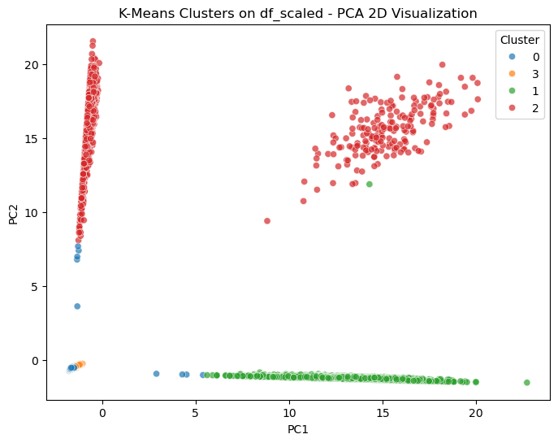
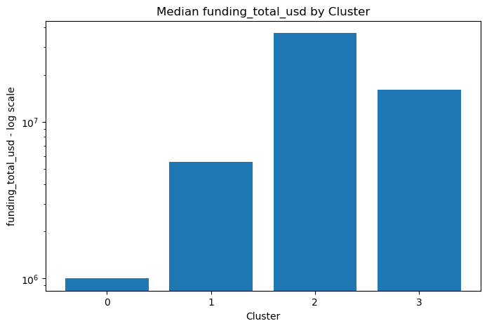
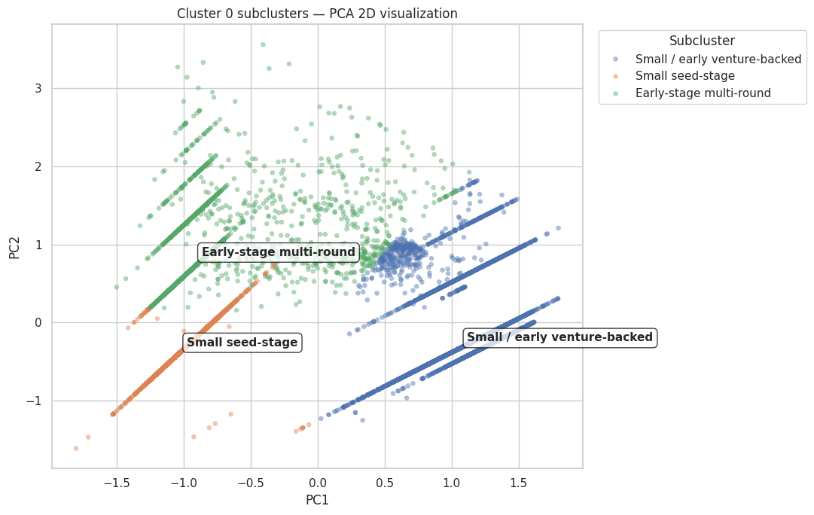
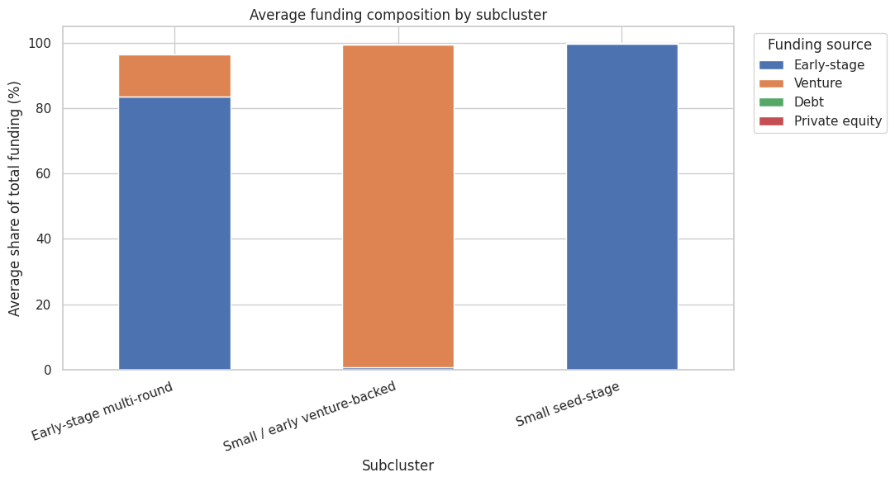

# Startup Funding Analysis Using Machine Learning

*Machine Learning II — University Group Project, NOVA IMS*

---

## Overview

This repository contains an academic unsupervised learning project developed as part of the Machine Learning II course during Data Science studies at NOVA IMS. The project explores how clustering techniques can identify distinct startup financing profiles from historical investment data.

Startups rely on fundamentally different capital structures depending on their industry, growth stage, and risk profile—ranging from lean bootstrapping and seed grants to venture capital rounds, venture debt facilities, and private equity investments. By analyzing funding distributions, round progressions, and capital allocations across thousands of companies, this project applies K-Means clustering and Principal Component Analysis (PCA) to uncover empirical investment patterns without relying on predefined labels.

The analysis is organized across three main Jupyter notebooks, covering data cleaning and feature engineering ([`teste.ipynb`](teste.ipynb)), four-cluster profiling ([`analise_clustering.ipynb`](analise_clustering.ipynb)), and a dedicated subclustering analysis of early-stage startups ([`cluster0_subclustering_analysis.ipynb`](cluster0_subclustering_analysis.ipynb)). An interactive companion web application is also included in [`clustering-explorer/`](clustering-explorer/).

---

## Objectives

- Clean and preprocess a high-dimensional, highly sparse historical venture investment dataset.
- Address severe zero-inflation across funding rounds and capital types through domain-specific feature engineering.
- Reduce dimensionality with Principal Component Analysis (PCA) while preserving the primary continuous variance of the feature space.
- Apply K-Means clustering to identify distinct startup financing profiles and evaluate cluster separation.
- Profile and interpret the resulting clusters using median financial values, funding ratios, company status distributions, and industry representation.
- Conduct a deeper subclustering analysis on the dominant early-stage segment (Cluster 0) to untangle its internal heterogeneity.

---

## Dataset

The analysis uses a historical Crunchbase venture investments dataset ([`investments_VC.csv`](investments_VC.csv)), widely distributed on Kaggle. The dataset contains investment records covering company names, market sectors, operating statuses, locations, round counts, and funding amounts across various financing stages and vehicles.

### Filtering Pipeline

The raw dataset contains **54,294 records** and **39 columns**. The final clustering dataset contains **36,931 startups** and **11 engineered numerical features**. The reduction followed these specific filtering steps:

1. **Empty Record Removal:** 4,856 rows where all fields were missing were removed via `dropna(how='all')`, leaving 49,438 records.
2. **Missing Name Drop:** 1 row missing the startup name was removed, leaving 49,437 records.
3. **Irrelevant Column Pruning:** Non-informative identifier and temporal attributes (`permalink`, `homepage_url`, `state_code`, `region`, `founded_month`, `founded_quarter`, `founded_year`) were dropped.
4. **Targeted Missing Value Removal:** Startups missing `funding_total_usd` or `market` were dropped (11,039 records removed), as both are vital attributes for financial profiling, leaving 38,398 records.
5. **Zero-Funding Removal:** 1,467 companies (3.82%) reporting $0 across all evaluated funding categories were dropped, yielding the final sample of **36,931 startups**.

> [!NOTE]
> This dataset represents a historical snapshot reflecting funding activity up to approximately 2014. It is not a live or current database, and startup valuation norms have changed substantially since this data was collected.

---

## Methodology

### Handling Zero-Inflation and Sparsity

A central challenge in venture capital data is extreme sparsity: most startups raise capital from only one or two specific mechanisms. Over 98% to 99% of values in columns such as `equity_crowdfunding`, `undisclosed`, `convertible_note`, `post_ipo_equity`, `post_ipo_debt`, `secondary_market`, and `product_crowdfunding` were zeros. These seven columns were removed.

Similarly, individual funding round columns (`round_A` through `round_H`) each contained 95% to 99.5% zeros. Rather than keeping sparse binary indicators, an ordinal feature was engineered:

- **`stage_level` (0 to 8):** Encodes the furthest funding round attained by the startup (0 = none, 1 = Round A, up to 8 = Round H), condensing the company's trajectory into a single informative column before dropping the individual round columns.

### Feature Engineering

To capture both the scale and the relative composition of capital, 11 features were engineered:

1. **Early-Stage Aggregation:** `seed`, `angel`, and `grant` funding were combined into a unified `early_stage_funding` metric to mitigate sparsity.
2. **Funding Composition Ratios:** Four proportions were calculated relative to total funding and clipped to $[0, 1]$:
   - `early_stage_funding_ratio`
   - `venture_ratio`
   - `debt_financing_ratio`
   - `private_equity_ratio`
3. **Log Transformations:** Extreme right-skewness and heavy tails were moderated using $\log(1 + x)$ on all monetary amounts and counts: `log_funding_total_usd`, `log_funding_rounds`, `log_early_stage_funding`, `log_venture`, `log_debt_financing`, and `log_private_equity`.
4. **Round Trajectory:** `stage_level`.

### Feature Scaling

Startup funding spans orders of magnitude (from a few thousand dollars to billions). Because standard z-score normalization is distorted by extreme outliers, **`RobustScaler`** was used. It centers features by the median and scales according to the Interquartile Range (IQR).

### PCA: Clustering vs. Visualisation

Principal Component Analysis (PCA) served two distinct purposes in the project:

- **PCA for Clustering:** A 3-component PCA was fitted on the 11 scaled features (`df_scaled`). These 3 components captured **95.78%** of the cumulative variance, reducing noise and multicollinearity while serving as the direct input space for the primary K-Means algorithm.
- **PCA for Visualisation:** A separate 2-component PCA projection was fitted solely for 2D visual representation in the notebooks and companion explorer, accounting for **89.31%** of the variance (PC1: 60.48%, PC2: 28.83%).

### K-Means Clustering

K-Means was executed with `k-means++` initialization, `n_clusters=4`, and `random_state=42`. A sensitivity comparison between clustering on the 3 principal components versus clustering directly on the 11 scaled features confirmed structural consistency: Clusters 1 and 2 were identical across both approaches, while Clusters 0 and 3 shifted by only 474 observations (~1.3%). The model fitted on PCA was exported to [`clustered_startups_real_values.csv`](clustered_startups_real_values.csv).

---

## Results

The K-Means model segments the 36,931 startups into four distinct financing profiles:

| Cluster | Profile Name | Count | Share | Median Total Funding | Median Rounds | Dominant Capital Source | Operating / Acquired / Closed |
|:---:|---|---:|---:|---:|---:|---|:---:|
| **0** | Early-stage / Seed / Mixed Low Funding | 24,102 | 65.26% | $1,000,000 | 1 | Seed, angel, grants, and small venture checks | 87.8% / 5.7% / 6.5% |
| **1** | Debt-Financed Startups | 3,819 | 10.34% | $5,550,000 | 3 | Credit & debt facilities combined with venture | 86.1% / 9.3% / 4.6% |
| **2** | Private Equity / Capital Intensive | 1,305 | 3.53% | $36,850,000 | 2 | Large buyout & private equity growth capital | 90.3% / 8.1% / 1.7% |
| **3** | Venture-Backed Growth | 7,705 | 20.86% | $14,906,222 | 2 | Institutional venture capital (Series A/B+) | 78.0% / 17.4% / 4.6% |

### Profile Summaries

- **Cluster 0 (Early-Stage / Low Funding):** Represents the majority of startups in the database. Capital intake is modest (median $1.00M), typically from a single round. Because this cluster groups together small grants, seed rounds, and early venture checks, it exhibits significant internal diversity (examined in the subclustering analysis).
- **Cluster 1 (Debt-Financed Startups):** Companies combining equity venture rounds with substantial credit/debt facilities (median debt $1.32M, median venture $1.45M across 3 rounds). Debt is used alongside venture equity to fund asset-heavy operations or working capital while minimizing equity dilution.
- **Cluster 2 (Private Equity / Capital Intensive):** Mature, capital-intensive firms with the highest median funding ($36.85M, with median private equity funding of $18.40M). They show the lowest closure rate in the dataset (1.67%).
- **Cluster 3 (Venture-Backed Growth):** Follows the classical institutional venture capital trajectory (median venture funding $14.00M, median stage level 2). These companies exhibit by far the highest acquisition rate (**17.35%**, three times higher than early-stage startups).

---

## Further Analysis: Cluster 0

Cluster 0 accounts for **65.26%** (24,102 companies) of all analyzed startups. Because it encompasses everything from a $15,000 grant to a $2.8M venture round, treating it as a homogeneous group masks early-stage dynamics.

In [`cluster0_subclustering_analysis.ipynb`](cluster0_subclustering_analysis.ipynb), a secondary K-Means clustering ($K=3$) was performed on the scaled features of Cluster 0. Internal metrics evaluated across $K=2$ to $K=9$ showed reasonable cohesion ($K=3$ achieved an average silhouette score of 0.505 and inertia of 15,318), while providing three interpretable sub-profiles:

| Subcluster | Subcluster Name | Startups | Cluster 0 Share | Median Funding | Median Rounds | Dominant Funding Mix | Over-Represented Markets (Lift) |
|:---:|---|---:|---:|---:|---:|---|---|
| **0** | Small / early venture-backed | 10,902 | 45.23% | $2,840,500 | 1.0 | 98.7% Venture share (100% venture participation) | Biotechnology (1.81x), Clean Technology (1.63x) |
| **1** | Early-stage multi-round | 4,114 | 17.07% | $900,000 | 2.0 | 83.5% Early-stage, 12.9% Venture share | Big Data (2.03x), Analytics (1.19x) |
| **2** | Small seed-stage | 9,086 | 37.70% | $250,000 | 1.0 | 99.8% Early-stage share (seed, angel, grants) | Apps (1.79x), Android (1.33x) |

### Key Takeaways from Subclustering

1. **Venture Capital Penetration at Early Stages:** Almost half of Cluster 0 (45.23%) consists of companies whose capital comes entirely from venture capital, but in amounts smaller than the late-stage institutional rounds of Cluster 3. These startups concentrate in research- and hardware-intensive sectors like Biotechnology and Clean Technology.
2. **Capital Efficiency vs. R&D Requirements:** Software, mobile app, and Android developers cluster heavily in the small seed-stage group ($250k median), reflecting lower initial capital requirements.
3. **Follow-On Traction:** The multi-round group ($900k median, 2 rounds) reflects startups that raised initial seed capital and managed to secure small follow-on venture checks, demonstrating initial commercial traction.

The subclustering results were exported to [`cluster0_subclustered_explained.csv`](cluster0_subclustered_explained.csv) and [`cluster0_subcluster_profiles.xlsx`](cluster0_subcluster_profiles.xlsx).

---

## Visualisations

The figures below were exported directly from the project's analysis notebooks:

### Cluster Separation in 2D Space

*Figure 1: 2D PCA projection of the four primary clusters (from [`teste.ipynb`](teste.ipynb)). Debt-financed startups (Cluster 1, green) and private equity firms (Cluster 2, red) separate along distinct axes from the central equity/seed density (Clusters 0 and 3).*

### Financial Scale Across Clusters

*Figure 2: Median total funding across the four clusters on a logarithmic scale (from [`analise_clustering.ipynb`](analise_clustering.ipynb)), highlighting the substantial scale differences between early-stage accounts ($1.0M) and private equity buyouts ($36.85M).*

### Subcluster Structure Within Cluster 0

*Figure 3: 2D PCA projection of Cluster 0 into three distinct subclusters (from [`cluster0_subclustering_analysis.ipynb`](cluster0_subclustering_analysis.ipynb)), separating small venture-backed companies from pure seed and multi-round early-stage startups.*

### Funding Composition of Subclusters

*Figure 4: Average funding source breakdown across the three subclusters in Cluster 0 (from [`cluster0_subclustering_analysis.ipynb`](cluster0_subclustering_analysis.ipynb)), showing the sharp boundary between pure seed and early venture allocations.*

---

## Key Insights

- **Debt as a Venture Complement, Not a Seed Alternative:** Startups in Cluster 1 rarely rely on debt alone. They combine significant debt facilities (median $1.32M) with institutional venture capital (median $1.45M) over multiple rounds (median 3), indicating that debt is typically accessible only after securing venture backing.
- **Acquisition Probability Tracks Institutional Venture Backing:** Startups in Cluster 3 (Venture-Backed Growth) show an acquisition rate of 17.35%, compared to 5.71% in Cluster 0 and 8.09% in Cluster 2. While this does not imply that venture funding causes acquisitions, it highlights that institutional VC investment is closely aligned with M&A exit paths.
- **Capital Intensity Follows Industry Requirements:** Industry distribution is strongly associated with funding profiles. Capital-intensive domains (Biotechnology, Clean Tech) are heavily over-represented in venture-backed groups, while consumer software and mobile products are concentrated in lightweight seed rounds.
- **Macro Clusters Require Granular Inspection:** A high-level four-cluster model provides a solid macro view, but the 65% concentration in Cluster 0 demonstrated that high-level clustering must be complemented by targeted sub-segmentation when analyzing skewed real-world data.

---

## Interactive Explorer

The repository includes a companion web application located in [`clustering-explorer/`](clustering-explorer/):

- **Architecture:** Client-side single-page application built with vanilla HTML5, CSS3, and ES6 JavaScript. Uses Chart.js (v4.4.1) and PapaParse (v5.4.1) for local rendering.
- **Purpose:** Serves as an interactive exploratory dashboard to inspect exported CSV results ([`clustered_startups_real_values.csv`](clustered_startups_real_values.csv) and [`cluster0_subclustered_explained.csv`](cluster0_subclustered_explained.csv)).
- **Capabilities:**
  - "Zero Problem" panel detailing sparsity across funding sources.
  - Interactive 2D PCA scatter plot colored by cluster.
  - Cluster profile cards and summary heatmaps.
  - Searchable and filterable data table of individual companies.
  - Dedicated subclustering tab for Cluster 0.
- **Important Distinction:** The explorer is a read-only presentation interface for exported results. It does not execute Python code, retrain models, or modify source datasets.

For details on running the application, refer to [`clustering-explorer/README.md`](clustering-explorer/README.md).

---

## Technologies

### Machine Learning & Data Science Pipeline
- **Python 3.10+**
- **pandas** (Data manipulation and aggregations)
- **numpy** (Logarithmic transformations and numerical operations)
- **scikit-learn** (`RobustScaler`, `KMeans`, `PCA`, `silhouette_score`)
- **matplotlib** & **seaborn** (Static visualisations and distribution plots)
- **scipy** (`stats.chi2_contingency`, `stats.kruskal` for statistical tests)
- **plotly** (Exploratory 3D scatter plots)
- **openpyxl** (Exporting profile workbooks)
- **Jupyter Notebook** (Interactive research environment)

### Companion Web Explorer
- **HTML5 & CSS3** (Responsive interface styling)
- **JavaScript (ES6 Modules)** (Data filtering and event orchestration)
- **Chart.js** (Interactive canvas charts)
- **PapaParse** (In-browser CSV parsing)

---

## Repository Structure

```text
MLII/
├── README.md                              # Main project documentation
├── analise_clustering.ipynb               # Four-cluster statistical profiling & visual analysis
├── cluster0_subclustering_analysis.ipynb  # Cluster 0 deep-dive & subclustering (K=3)
├── teste.ipynb                            # Main pipeline: cleaning, feature engineering, PCA, K-Means
│
├── investments_VC.csv                     # Raw Crunchbase dataset (54,294 rows)
├── clustered_startups_real_values.csv     # Exported clustered dataset (36,931 startups, K=4)
├── cluster0_subclustered_explained.csv    # Exported Cluster 0 dataset with subclusters (K=3)
├── cluster0_subcluster_profiles.xlsx      # Summary Excel profile of Cluster 0 subclusters
│
├── add_pca_columns.py                     # Helper script to compute 2D PCA columns for CSV
├── teste_code.py                          # Procedural script export of teste.ipynb
├── teste_code2.py                         # Partial procedural script export of teste.ipynb
│
├── docs/
│   └── figures/                           # Visual figures exported from notebooks for documentation
│       ├── cluster_pca_2d.png
│       ├── cluster_median_funding.png
│       ├── cluster0_subclusters_pca.png
│       ├── cluster0_funding_composition.png
│       └── cluster0_elbow_silhouette.png
│
└── clustering-explorer/                   # Companion client-side interactive web application
    ├── index.html                         # Application markup
    ├── README.md                          # Explorer documentation and local setup
    ├── pca_clusters.png                   # Reference 2D PCA plot
    ├── src/                               # JavaScript application modules & CSS
    └── vendor/                            # Bundled Chart.js and PapaParse libraries
```

---

## Running the Project

### Exploring the Notebooks

1. Clone or download the repository.
2. Set up a Python virtual environment (Python 3.10 or later recommended):
   ```bash
   python -m venv .venv
   # Windows (PowerShell):
   .venv\Scripts\Activate.ps1
   # macOS / Linux:
   source .venv/bin/activate
   ```
3. Install standard scientific Python dependencies:
   ```bash
   pip install pandas numpy scikit-learn matplotlib seaborn scipy plotly openpyxl jupyter
   ```
   *(Note: The repository does not include a frozen `requirements.txt`; standard recent releases of the above libraries are compatible with the codebase).*
4. Launch Jupyter Notebook or JupyterLab:
   ```bash
   jupyter notebook
   ```
5. Open the notebooks in sequence:
   - [`teste.ipynb`](teste.ipynb): Full preprocessing, feature engineering, and primary K-Means clustering.
   - [`analise_clustering.ipynb`](analise_clustering.ipynb): Post-clustering cluster profiling.
   - [`cluster0_subclustering_analysis.ipynb`](cluster0_subclustering_analysis.ipynb): Subclustering analysis of Cluster 0.

### Running the Interactive Explorer

Because modern web browsers restrict cross-origin local file fetching (`file://`), launch a lightweight local HTTP server from the repository root:

```powershell
python -m http.server 8000
```

Then navigate to:

```text
http://localhost:8000/clustering-explorer/
```

---

## Limitations

- **Historical Cross-Sectional Data:** The dataset is a snapshot reflecting investments up to approximately 2014. Market valuations, round sizes, and venture funding norms have grown substantially over the last decade.
- **Reporting and Survivorship Bias:** Crunchbase data is largely crowd-sourced and self-reported. Successful startups and high-profile funding rounds are substantially more likely to be reported and updated than unannounced failures or dormant projects.
- **Extreme Sparsity:** Many specialized financing vehicles (crowdfunding, secondary markets, convertible notes) were populated in less than 1% of records, necessitating their removal and limiting the analysis primarily to equity, debt, and stage counts.
- **Observational Associations:** Cluster assignments reflect empirical funding profiles in this specific dataset. They do not demonstrate causal drivers of startup success, valuation growth, or exit probability.

---

## Academic Context

This project was developed as a university group assignment for the **Machine Learning II** course within the Data Science program at **NOVA Information Management School (NOVA IMS)**, Lisbon, Portugal.
